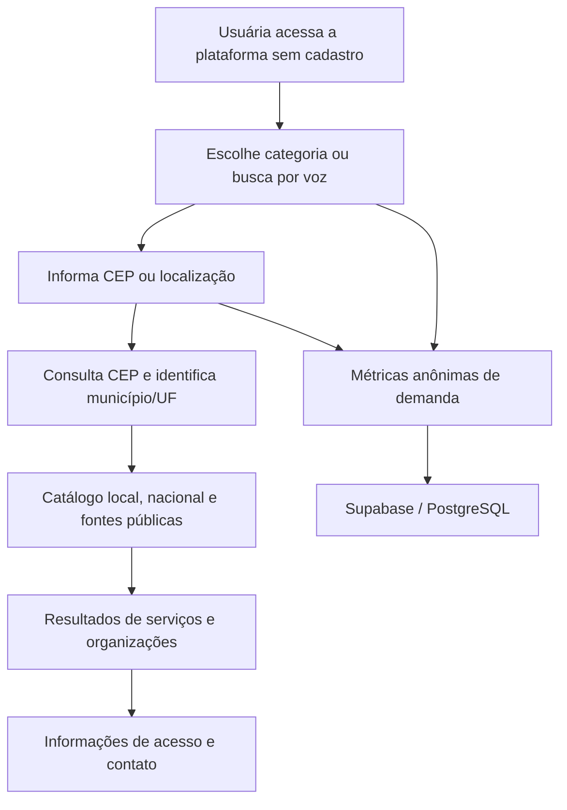

# 🌸 AcolheMulher

**Rede aberta de apoio, proteção, assistência e capacitação para mulheres no Brasil.**

O **AcolheMulher** é uma plataforma web responsiva, com suporte a instalação como aplicativo PWA, que facilita a busca por serviços gratuitos de apoio às mulheres. A proposta é reduzir a distância entre quem precisa de ajuda e a rede de atendimento, organizando as opções por categoria e localização.

> **Você não precisa criar uma conta para pesquisar.** A plataforma foi concebida para permitir o acesso sem cadastro, login, e-mail ou senha.

[**Acessar a plataforma**](https://ais-dev-r2gpsznwryzoskbbumntwb-755060135040.us-west2.run.app) · [Repositório GitHub](https://github.com/karolcastro/acolheMulher)

---

## 🧭 O que a plataforma oferece

A usuária pode escolher a categoria de apoio e informar um CEP para localizar serviços relacionados à região. A aplicação também contempla busca por voz, consulta de serviços de saúde públicos e um diretório de organizações.

| Categoria | Exemplos de apoio |
|---|---|
| 🚨 Proteção e emergência | Ligue 180, Polícia 190, delegacias e serviços de acolhimento |
| ⚖️ Orientação jurídica | Defensorias Públicas, orientação sobre direitos e proteção |
| 🧠 Apoio psicológico | Redes de acolhimento e apoio emocional |
| 🏥 Saúde | Unidades públicas de saúde e serviços do SUS |
| 🎓 Cursos e geração de renda | Capacitação profissional e iniciativas voltadas às mulheres |
| 🤝 ONGs e projetos sociais | Organizações, coletivos e iniciativas de apoio |

### Prioridade para formação de mulheres

Nas buscas por cursos e oportunidades, a proposta do projeto é priorizar iniciativas criadas por mulheres para mulheres ou destinadas especificamente ao público feminino. Entre as referências a investigar estão PyLadies, Todas em Tech, AI Girls, PrograMaria, WoMakersCode, Cloud Girls, Minas Programam, PretaLab e Meninas Digitais.

Esses nomes são referências de pesquisa, não uma confirmação de que tenham cursos ou inscrições abertas. A gratuidade, o público elegível, a modalidade e o prazo precisam ser verificados em fonte oficial antes de apresentar uma oportunidade como disponível.

---

## ✨ Funcionalidades implementadas no código

- **Pesquisa por CEP:** consulta de endereço e identificação de município e UF, com integração ao ViaCEP.
- **Catálogo por categoria e região:** combinação de serviços nacionais, dados regionais e registros disponibilizados pelo banco.
- **Consulta de unidades públicas de saúde:** endpoint de consulta ao CNES/Dados Abertos do Ministério da Saúde, com apoio da API de localidades do IBGE.
- **Busca por voz:** envio de áudio ao backend para transcrição com Gemini, quando a chave de API está configurada.
- **Diretório de ONGs:** visualização de organizações e projetos de apoio às mulheres.
- **Área para organizações parceiras:** interface para gerar widget, sugerir/cadastrar ONGs e consultar estatísticas de demanda.
- **PWA:** aplicação instalável em dispositivos compatíveis, com service worker e recursos de acesso offline.
- **Acesso rápido de saída:** atalho pela tecla `ESC` e botão na interface.
- **Modo camuflagem:** alternativa visual que substitui a tela principal por uma página neutra.

> **Importante sobre segurança:** o botão de saída rápida redireciona para outro endereço e a aplicação limpa os storages locais que consegue acessar. Isso não garante a exclusão do histórico do navegador, de registros de rede ou de dados mantidos por terceiros. O modo camuflagem também não substitui um dispositivo seguro. Se houver risco de monitoramento, considere usar um dispositivo confiável e apague o histórico apenas se isso não aumentar o risco.

---

## 🧱 Arquitetura e tecnologias

| Camada | Tecnologia | Responsabilidade |
|---|---|---|
| Interface | React 19 | Componentes e experiência da usuária |
| Linguagem | TypeScript | Tipagem e organização do código |
| Build e desenvolvimento | Vite | Servidor de desenvolvimento e build |
| Estilização | Tailwind CSS v4 | Layout responsivo e estilos |
| Servidor | Node.js + Express | Endpoints de backend |
| Banco de dados | Supabase / PostgreSQL | Catálogo, organizações e métricas agregadas |
| IA de voz | Google Gemini API | Transcrição de áudio enviada ao backend |
| CEP | ViaCEP | Consulta de endereço a partir do CEP |
| Saúde pública | API CNES/Dados Abertos do Ministério da Saúde | Consulta de estabelecimentos de saúde |
| Localidades | API de localidades do IBGE | Apoio à identificação do município |
| Aplicativo | Vite PWA Plugin | Manifesto, instalação e cache offline |
| Widget | Interface de integração para sites parceiros | Compartilhamento do buscador |

### Visão simplificada do fluxo



---

## 📊 Métricas de demanda e privacidade

O projeto possui uma rotina opcional de registro de demanda anônima no Supabase. O objetivo é permitir análises agregadas, como:

- categorias de apoio mais pesquisadas;
- estados, municípios e macrorregiões com maior procura;
- canais de acesso utilizados;
- volume de buscas por período.

A rotina de métricas foi implementada para não enviar CEP completo, coordenadas, IP, nome, CPF, e-mail ou identificadores do navegador. Para a análise territorial, são utilizados categoria, UF e município. A aplicação também normaliza a transcrição de buscas por voz antes de registrar os dados relacionais; o áudio original não é gravado por essa rotina de métricas.

**Atenção:** a busca por voz envia o áudio ao backend e, quando configurada, à API Gemini para transcrição. A transcrição normalizada pode conter palavras da solicitação. Por segurança, não dite nomes, documentos, endereços completos ou relatos íntimos. O registro de métricas depende da configuração do Supabase; sem essa configuração, a aplicação não grava essas métricas.

O cliente Supabase está configurado sem persistência de sessão no navegador. Isso não deve ser interpretado como garantia de anonimato absoluto: hospedagem, navegador, APIs externas e provedores podem manter seus próprios registros técnicos, conforme suas políticas.

---

## 🛠️ Como executar localmente

### Pré-requisitos

- Node.js compatível com a versão do Vite utilizada no projeto (recomendado Node.js 20.19+ ou 22.12+).
- npm.
- Projeto Supabase, se desejar habilitar banco de dados e métricas.
- Chave Gemini, se desejar habilitar transcrição por voz.

### 1. Clonar o repositório

```bash
git clone https://github.com/karolcastro/acolheMulher.git
cd acolheMulher
```

### 2. Instalar as dependências

```bash
npm install
```

### 3. Configurar variáveis de ambiente

Crie um arquivo `.env` na raiz do projeto. Use `.env.example` como referência:

```env
# Frontend - Supabase (opcional)
VITE_SUPABASE_URL=
VITE_SUPABASE_ANON_KEY=

# Backend - Gemini (necessária para transcrição por voz)
GEMINI_API_KEY=

# Backend - outras configurações usadas pelo projeto
APP_URL=
ACOLHE_ALLOWED_ORIGIN=
SUPABASE_URL=
SUPABASE_ANON_KEY=
ACOLHE_PARTNER_TOKEN=
```

Preencha apenas as variáveis necessárias ao ambiente. **Nunca publique chaves secretas, tokens ou credenciais no GitHub.** A chave pública `anon` do Supabase deve estar protegida pelas políticas de acesso (RLS) adequadas no banco.

### 4. Iniciar em desenvolvimento

```bash
npm run dev
```

O servidor Express inicia na porta 3000 por padrão (ou na porta definida pela variável `PORT`) e integra o middleware de desenvolvimento do Vite.

### 5. Gerar o build de produção

```bash
npm run build
```

Para visualizar o build localmente:

```bash
npm run preview
```

O comando `npm run start` inicia o servidor Express em modo de produção; nesse modo, o diretório `dist` precisa existir.

---

## 🔐 Configurações e integrações

- **Supabase:** configure `VITE_SUPABASE_URL` e `VITE_SUPABASE_ANON_KEY` no frontend. As funções de catálogo e métricas dependem de tabelas, views, RPCs e políticas existentes no projeto Supabase.
- **Gemini:** configure `GEMINI_API_KEY` no ambiente do servidor para habilitar o endpoint `/api/transcribe`.
- **CNES:** a consulta pública é realizada pelo endpoint `/api/cnes-public`.
- **CEP:** a consulta de endereço utiliza o ViaCEP.
- **PWA:** o manifesto e o service worker são gerados pela configuração do plugin PWA no Vite.

Os scripts SQL necessários ao banco devem ser aplicados no projeto Supabase correspondente. Consulte os arquivos SQL existentes no repositório antes de configurar um ambiente novo; a aplicação pode funcionar com o catálogo local mesmo sem Supabase configurado, mas recursos que dependem do banco ficam indisponíveis.

---

## 🆘 Telefones importantes no Brasil

Se houver perigo imediato, procure um local seguro e ligue **190 — Polícia Militar**. Para orientação e denúncia de violência contra a mulher, ligue **180 — Central de Atendimento à Mulher**. Para apoio emocional, o **CVV atende pelo 188**.

A plataforma é uma facilitadora de acesso à rede de serviços; não substitui atendimento policial, jurídico, psicológico ou de saúde.

---

## 🗺️ Diretrizes do projeto

1. **Acesso sem cadastro:** não exigir conta, login, e-mail ou senha para pesquisar.
2. **Gratuidade:** priorizar serviços gratuitos e informar restrições ou custos quando existirem.
3. **Confiabilidade:** dar preferência a fontes oficiais e institucionais e indicar quando uma informação não foi verificada.
4. **Localização útil:** considerar CEP, município e UF para apresentar opções compatíveis com a região.
5. **Privacidade:** evitar a coleta de dados pessoais e não armazenar relatos sensíveis desnecessariamente.
6. **Acolhimento:** utilizar linguagem clara, respeitosa e sem julgamentos.
7. **Formação feminina:** priorizar cursos, bolsas e programas destinados especificamente às mulheres, especialmente iniciativas lideradas por mulheres.

---

## 👩‍💻 Autoria

Projeto idealizado e desenvolvido por **Karol Castro**, no contexto da formação **{reprograma}**.

- GitHub: [@karolcastro](https://github.com/karolcastro)
- Repositório: [karolcastro/acolheMulher](https://github.com/karolcastro/acolheMulher)

---

## 📄 Licença

O repositório contém um badge MIT no README anterior. Consulte o arquivo `LICENSE` do projeto para confirmar os termos e condições aplicáveis.
