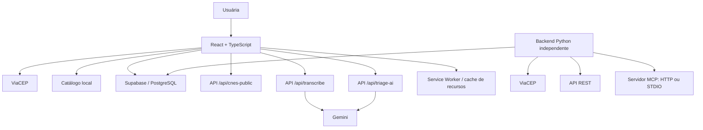

# AcolheMulher

Plataforma web responsiva e PWA que organiza o acesso a serviços gratuitos de proteção, acolhimento, saúde, orientação jurídica, capacitação e iniciativas de apoio a mulheres no Brasil. A consulta para usuárias não exige criação de conta, login ou fornecimento de dados cadastrais.

> **Importante:** o AcolheMulher é uma ferramenta de orientação e localização de serviços. Não substitui atendimento de emergência, avaliação profissional ou confirmação direta de disponibilidade do serviço.

[Repositório](https://github.com/karolcastro/acolheMulher) · [Guia de implantação](DEPLOY_VERCEL_SUPABASE.md) · [Arquitetura](docs/ARCHITECTURE.md) · [Banco de dados](docs/DATABASE.md) · [Privacidade e segurança](docs/SECURITY_PRIVACY.md)

---

## 1. Objetivo e funcionalidades

O projeto reúne um catálogo de serviços e permite explorar opções por assunto e região. O fluxo principal foi concebido para funcionar sem cadastro da usuária.

- **Busca por localização:** consulta de CEP e resolução de endereço por meio do ViaCEP; filtros e ordenação territorial são aplicados ao catálogo.
- **Categorias:** emergência e proteção, apoio psicológico, orientação jurídica, saúde, cursos e geração de renda, além de iniciativas e organizações de apoio.
- **Catálogo híbrido:** dados locais versionados no frontend e no backend Python, complementados por registros do Supabase quando a integração está configurada.
- **Unidades públicas de saúde:** endpoint CNES consulta dados públicos do Ministério da Saúde e aplica filtros de tipo, situação, natureza administrativa e coordenadas.
- **Busca por voz:** reconhecimento nativo do navegador quando disponível; há caminho alternativo de gravação e transcrição via Gemini no endpoint de servidor. A interpretação de texto também possui lógica local.
- **Triagem acolhedora com IA generativa + RAG:** no fluxo de acolhimento (`SupportTriageAgent`), a consulta a `POST /api/triage-ai` classifica categoria e urgência, resume passos práticos de segurança e recomenda até 4 serviços/ONGs presentes exclusivamente no contexto do catálogo enviado (`services` e `ngos`), com fallback determinístico local quando offline ou sem `GEMINI_API_KEY`.
- **Área de organizações parceiras:** formulário para propor/cadastrar ONGs no catálogo, com verificação de duplicidade e persistência via RPC do Supabase quando configurado.
- **Indicadores de demanda:** registro de contagens agregadas por assunto, data e região, além de estatísticas relacionais de buscas por voz, quando o Supabase e as migrations correspondentes estão ativos.
- **Acesso emergencial:** interface com telefones essenciais e orientações para acesso offline.
- **Modo camuflagem e saída rápida:** recursos de interface voltados à segurança digital, com limitações descritas em [Privacidade e segurança](docs/SECURITY_PRIVACY.md).
- **PWA:** instalação na tela inicial e cache do shell/arquivos estáticos e fontes. O modo offline não equivale a uma cópia offline de todo o catálogo ou das APIs.

## 2. Tecnologias identificadas no repositório

| Camada | Tecnologias / componentes | Uso |
|---|---|---|
| Frontend | React 19, TypeScript, Vite 8, Tailwind CSS 4, Lucide React, Motion | Interface, componentes e estilos |
| PWA | vite-plugin-pwa / Workbox | Manifesto, service worker, atualização e cache de recursos estáticos |
| Front End Node/TypeScript | Express 4, tsx, Google GenAI SDK | Servidor de desenvolvimento/execução própria e endpoints de saúde, CNES, transcrição e triagem por IA |
| API serverless | Arquivos TypeScript em `api/` | Endpoints `/api/cnes-public`, `/api/transcribe` e `/api/triage-ai` na plataforma compatível com a convenção Vercel |
| Backend Python | Python, biblioteca padrão, arquitetura em camadas | API REST independente e servidor MCP |
| Banco principal | Supabase / PostgreSQL | Catálogo remoto, organizações, políticas RLS e métricas agregadas |
| Integrações | ViaCEP, API pública CNES/IBGE, Gemini | Consulta de CEP, unidades de saúde, transcrição de áudio e triagem assistida por IA |

As dependências JavaScript e suas versões declaradas estão em [package.json](package.json); o lockfile do repositório é `bun.lock`.

## 3. Arquitetura em alto nível



O frontend, os endpoints TypeScript e o backend Python são partes distintas. O backend Python não é iniciado automaticamente pelo build Vite. Consulte [Arquitetura](docs/ARCHITECTURE.md) para responsabilidades, rotas e limites de integração.

## 4. Estrutura do repositório

| Caminho | Responsabilidade |
|---|---|
| `src/` | Aplicação React, componentes, contexto do catálogo, hooks, dados locais e utilitários |
| `api/` | Funções HTTP TypeScript para CNES, transcrição e triagem por IA |
| `server.ts` | Servidor Express com middleware Vite no desenvolvimento e opção de servir o build em execução própria |
| `backend/` | Backend Python em camadas, API REST, segurança e MCP |
| `supabase/migrations/` | Evolução do schema PostgreSQL, RLS, catálogo e analytics |
| `database/mysql/` | Script SQL alternativo para MySQL 8; não é o banco conectado pelo código da aplicação |
| `public/` | Ícones e recursos públicos do PWA |
| `DEPLOY_VERCEL_SUPABASE.md` | Guia de configuração e implantação |

## 5. Executar localmente

### Pré-requisitos

- Node.js compatível com as versões declaradas em `package.json`.
- npm ou Bun.
- Python 3 para executar o backend Python (opcional).
- Projeto Supabase e chave Gemini apenas para habilitar as integrações correspondentes.

### Frontend e endpoints Express locais

```bash
git clone https://github.com/karolcastro/acolheMulher.git
cd acolheMulher
npm install
npm run dev
```

O script `npm run dev` executa `tsx server.ts`, que inicia o Express e integra o middleware de desenvolvimento do Vite. O servidor usa a porta 3000 por padrão (ou a variável `PORT`).

### Build de produção do frontend

```bash
npm run build
npm run preview
```

O build Vite é gerado em `dist/`. O script `lint` executa a verificação de tipos TypeScript (`tsc --noEmit`); não é uma suíte completa de lint estilístico.

### Backend Python (opcional e independente)

```bash
python3 -m backend.main
```

Por padrão, o backend Python escuta em `127.0.0.1:8000`. Para executar o transporte MCP por STDIO:

```bash
python3 -m backend.mcp.server
```

A execução e as variáveis estão detalhadas em [Arquitetura](docs/ARCHITECTURE.md) e [Implantação](DEPLOY_VERCEL_SUPABASE.md).

## 6. Variáveis de ambiente

Nunca versione chaves reais. Use `.env.example` como referência e configure apenas as variáveis necessárias ao componente que será executado.

| Variável | Componente | Finalidade |
|---|---|---|
| `VITE_SUPABASE_URL` | Frontend | URL do projeto Supabase |
| `VITE_SUPABASE_ANON_KEY` | Frontend | Chave pública anon do Supabase, protegida por RLS |
| `SUPABASE_URL` | Backend Python | URL do Supabase |
| `SUPABASE_ANON_KEY` | Backend Python | Chave pública anon usada pelo repositório Python |
| `GEMINI_API_KEY` | API de transcrição, triagem / Express | Chave de servidor para Gemini; nunca usar como variável `VITE_*` |
| `GOOGLE_API_KEY` | API de transcrição, triagem / Express | Alternativa de nome aceita pelo código para a chave Gemini |
| `ACOLHE_ALLOWED_ORIGIN` | Backend Python | Origem permitida para CORS |
| `ACOLHE_HOST`, `ACOLHE_PORT` | Backend Python | Host e porta HTTP |
| `ACOLHE_PARTNER_TOKEN` | Backend Python | Token opcional para operações de parceiro protegidas |
| `ACOLHE_EPHEMERAL_SECRET` | Backend Python | Segredo opcional para gerar identificador efêmero do rate limiter |

O frontend funciona com catálogo local quando a conexão Supabase não está configurada ou não pode ser utilizada. Recursos remotos, gravação de métricas e persistência de novos registros dependem da configuração do Supabase e das migrations necessárias.

## 7. Banco de dados

O banco efetivamente integrado ao frontend e ao backend Python é Supabase/PostgreSQL. O histórico de evolução está em `supabase/migrations/001` a `008`; em uma instalação nova, execute os scripts em ordem. O modelo inclui tabelas de catálogo, dimensões e fatos analíticos, além de funções RPC e políticas RLS.

O arquivo em `database/mysql/` é uma implementação SQL alternativa de referência para MySQL 8.0+. O código atual da aplicação utiliza o cliente Supabase e não contém um adaptador de runtime MySQL.

Veja [Banco de dados](docs/DATABASE.md) para entidades, analytics, RLS e sequência de migrations.

## 8. Privacidade, segurança e limitações

- O fluxo de consulta para usuárias não exige cadastro, login, CPF, nome, e-mail ou telefone.
- A aplicação evita persistir CEP completo, IP e identificadores de navegação nas tabelas de analytics. Os indicadores armazenam assunto, data e região agregada; o módulo de voz pode armazenar transcrição normalizada/sanitizada sem os dígitos do CEP.
- O Supabase usa chave pública no cliente e políticas RLS; operações de escrita analítica e cadastro de ONG são feitas por RPCs específicas. Isso não significa ausência absoluta de dados: o catálogo contém dados públicos de serviços e organizações, e a região/assunto são dados analíticos.
- A transcrição e a triagem por Gemini exigem chave de servidor. O áudio de voz e o relato curto da triagem (até 400 caracteres, com cidade/UF opcionais sem CEP e resumo de itens do catálogo) são enviados aos endpoints de servidor e encaminhados ao provedor; não são gravados em tabela própria pelo código da aplicação.
- O PWA armazena recursos estáticos necessários ao shell da aplicação. Não há garantia de busca online, atualização de catálogo ou consulta a APIs sem conexão.
- A saída rápida limpa `localStorage` e `sessionStorage` da origem e navega para outra página; isso **não apaga o histórico do navegador, registros do provedor, DNS, rede, capturas de tela ou monitoramento externo**.
- Informações de serviços, horários, elegibilidade, gratuidade e disponibilidade podem mudar. Confirme com o órgão ou organização responsável antes de se deslocar.

Leia [Privacidade e segurança](docs/SECURITY_PRIVACY.md) antes de divulgar garantias de anonimato, sigilo ou segurança operacional.

## 9. Testes

O repositório contém testes Python em `backend/tests/`, executáveis com:

```bash
python3 -m unittest discover -s backend/tests -v
```

Também é possível executar `npm run lint` e `npm run build`. A existência dos testes no repositório não representa, por si só, evidência de que foram executados neste commit.

## 10. Autoria e licença

Projeto de impacto social desenvolvido por Karol Castro. Não foi localizado um arquivo `LICENSE` na árvore atual do repositório; portanto, a licença do código não deve ser presumida como MIT até que uma licença seja adicionada explicitamente.
