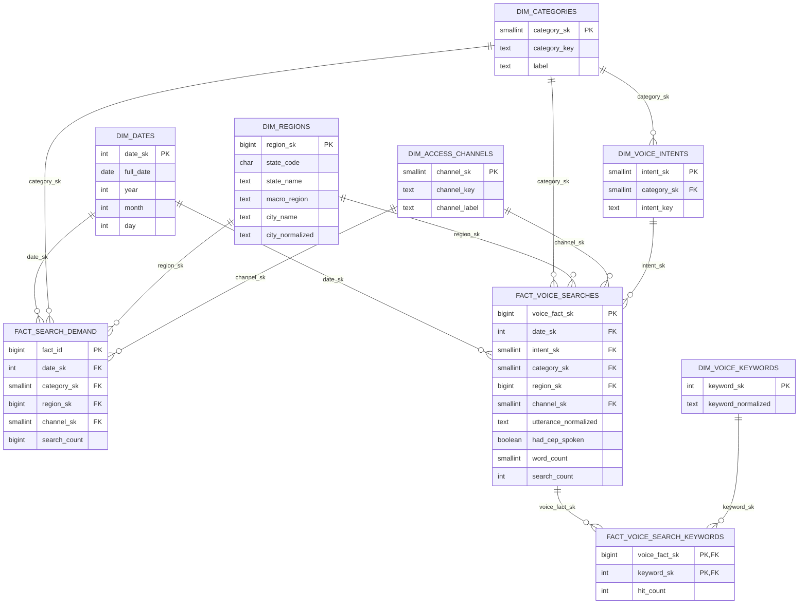

# Banco de dados — AcolheMulher

## 1. Banco utilizado pela aplicação

O código cliente utiliza `@supabase/supabase-js` e a API REST do Supabase. O backend Python também possui repositórios Supabase. Portanto, o banco conectado ao produto é **PostgreSQL gerenciado pelo Supabase**.

O arquivo `database/mysql/acolhemulher_mysql8_star_schema_utf8mb4.sql` é um script alternativo de referência para MySQL 8.0+. Não há adaptador MySQL no fluxo de execução atual do frontend ou do backend Python; executar esse SQL não conecta automaticamente a aplicação ao MySQL.

## 2. Migrations

Os arquivos estão em `supabase/migrations/` e devem ser lidos/executados em ordem numérica para uma instalação nova:

| Ordem | Arquivo | Escopo principal |
|---|---|---|
| 001 | `001_schema_rls.sql` | Estrutura inicial de perfis de parceiros, serviços e ONGs; políticas RLS e publicação Realtime |
| 002 | `002_enable_realtime.sql` | Ativação explícita de Realtime para tabelas do catálogo |
| 003 | `003_search_demand_stats.sql` | Primeira estrutura de contadores agregados de demanda e RPC de registro |
| 004 | `004_normalized_star_schema_rls.sql` | Evolução para dimensões e fatos analíticos, normalização e políticas de acesso |
| 005 | `005_ngos_dedupe_and_complete_search_tracking.sql` | Regras de deduplicação de ONGs, RPC de cadastro e ampliação do rastreamento por canal |
| 006 | `006_strict_3nf_star_schema_voice_rls.sql` | Normalização adicional e estrutura relacional para estatísticas de buscas por voz |
| 007 | `007_strict_zero_accents_zero_special_chars_all_tables.sql` | Sanitização e restrições de texto/normalização em tabelas e funções |

**Atenção:** o guia de implantação não deve orientar a executar apenas a migration 001 e presumir que todos os recursos mais recentes estarão disponíveis. A aplicação chama funções e views criadas em migrations posteriores. Em bancos já existentes, compare o histórico e o estado real antes de reaplicar scripts; faça backup e valide no ambiente de homologação.

## 3. Catálogo operacional

As tabelas centrais usadas pelo frontend são:

- `public.services`: serviços de atendimento e seus atributos de categoria, localização, acesso, gratuidade, verificação e situação.
- `public.ngos`: organizações/ONGs, área de atuação, abrangência, canais de acesso, resumo, formas de ajuda e categorias relacionadas.
- `public.partner_profiles`: estrutura de perfil de parceiro definida na migration inicial.

O frontend consulta `services` e `ngos` quando o Supabase está configurado. O código combina os registros remotos com os catálogos estáticos em `src/data/servicesData.ts` e `src/data/ngosData.ts`. Em falha/ausência de integração, o catálogo local funciona como fallback; a persistência remota de novos registros não está disponível nesse modo.

A migration 005 cria/atualiza a função `register_ngo_candidate`, utilizada pelo fluxo de cadastro de ONG no contexto do catálogo. A função aplica validações e controles de duplicidade no banco. A gravação depende da migration correspondente e de o Supabase estar acessível.

## 4. Arquitetura do banco — Star Schema

O banco possui duas áreas com finalidades diferentes:

1. **Operacional (OLTP):** mantém o catálogo consultado pela aplicação e os dados de administração das organizações parceiras.
2. **Analítica (OLAP):** organiza as pesquisas em tabelas fato e dimensões para permitir análises por período, assunto, localização e canal de acesso.

O Star Schema está implementado principalmente nas migrations 004 e 006. Ele é formado por duas tabelas fato que compartilham dimensões: a fato de demanda de pesquisa e a fato de pesquisas por voz. Essa organização também pode ser entendida como uma pequena *constelação de fatos*.

### 4.1 Desenho gráfico do Star Schema

O diagrama abaixo representa as relações de chave estrangeira definidas nas migrations. As tabelas fato ficam no centro; as dimensões fornecem o contexto para analisar cada registro.

**Como ler o desenho:**
- `FACT_SEARCH_DEMAND` é a fato principal de volume de pesquisas. Seu grão é uma linha agregada por combinação de data, categoria, região e canal.
- `FACT_VOICE_SEARCHES` registra as pesquisas por voz de forma relacional, acrescentando a intenção identificada e a consulta normalizada.
- `FACT_VOICE_SEARCH_KEYWORDS` é uma tabela associativa que relaciona cada registro de pesquisa por voz às palavras-chave encontradas.
- `DIM_VOICE_INTENTS` também referencia `DIM_CATEGORIES`, relacionando a intenção reconhecida ao assunto correspondente.

### 4.2 Tabelas do Star Schema

| Grupo | Tabela | Papel no modelo |
|---|---|---|
| Fato | `fact_search_demand` | Contagem agregada de pesquisas por data, categoria, região e canal |
| Fato | `fact_voice_searches` | Contagem e atributos normalizados das pesquisas por voz |
| Associativa | `fact_voice_search_keywords` | Relaciona pesquisas por voz às palavras-chave identificadas |
| Dimensão | `dim_dates` | Calendário: data, dia, mês, ano e atributos temporais |
| Dimensão | `dim_categories` | Assuntos/categorias pesquisados |
| Dimensão | `dim_regions` | UF, nome do estado, macrorregião e município normalizado |
| Dimensão | `dim_access_channels` | Origem/canal da pesquisa, como web ou voz |
| Dimensão | `dim_voice_intents` | Intenção identificada na pesquisa por voz |
| Dimensão | `dim_voice_keywords` | Vocabulário normalizado extraído das pesquisas por voz |

**Métricas e atributos das fatos:**
- Na `fact_search_demand`, a métrica principal é `search_count`.
- Na `fact_voice_searches`, são armazenados `search_count`, `word_count`, `had_cep_spoken` e `utterance_normalized`.
- Na `fact_voice_search_keywords`, `hit_count` registra a ocorrência da palavra-chave relacionada à pesquisa.

### 4.3 Tabelas operacionais e de apoio (fora do núcleo fato/dimensão)

Estas tabelas dão suporte ao catálogo, à administração e à normalização dos dados. Elas não devem ser interpretadas como fatos centrais do Star Schema.

| Tabela | Finalidade |
|---|---|
| `services` | Catálogo de serviços públicos e pontos de atendimento |
| `ngos` | Catálogo de ONGs e projetos de apoio |
| `partner_profiles` | Perfil e papel de organizações parceiras/administradoras |
| `tags` | Vocabulário de etiquetas para serviços |
| `service_tags` | Associação muitos-para-muitos entre serviços e etiquetas |
| `ngo_categories` | Associação entre ONGs e categorias |
| `dim_organizations` | Domínio normalizado de organizações |
| `dim_ngo_areas` | Domínio normalizado de áreas de atuação de ONGs |
| `dim_subcategories` | Domínio normalizado de subcategorias de serviços |
| `dim_access_modes` | Domínio normalizado de modalidades de acesso |
| `ngo_help_items` | Itens de ajuda associados a uma ONG |

As tabelas `dim_organizations`, `dim_ngo_areas`, `dim_subcategories` e `dim_access_modes` apoiam a normalização 3FN do catálogo. Apesar do prefixo `dim_`, elas não fazem parte das ligações centrais das duas tabelas fato exibidas no diagrama acima.

### 4.4 Views de consulta analítica

O frontend consulta views para consumir os dados já relacionados às dimensões:

| View | Conteúdo |
|---|---|
| `vw_star_search_demand` | Pesquisas agregadas com data, categoria, região e canal |
| `vw_star_demand_totals` | Total agregado de pesquisas |
| `vw_star_voice_searches` | Pesquisas por voz com intenção, categoria, região e consulta normalizada |

Também existem views operacionais `vw_services_normalized` e `vw_ngos_normalized`, usadas para expor os dados do catálogo em formato normalizado.

### 4.5 Estrutura legada

A tabela `search_demand_stats`, criada na migration 003, é uma estrutura anterior ao Star Schema. O código ainda tenta consultá-la como fallback quando não consegue obter os dados da view `vw_star_search_demand`. Portanto, ela deve ser identificada como legado, e não como parte do modelo dimensional atual.

### 4.6 Fluxo resumido dos dados

1. A aplicação identifica a categoria, a região (UF/município) e o canal da pesquisa.
2. A RPC `record_star_search_demand` registra/incrementa a combinação nas dimensões e em `fact_search_demand`.
3. Para pesquisas por voz, a aplicação sanitiza a transcrição e chama `record_voice_search_relational`.
4. A RPC relaciona a pesquisa com data, intenção, categoria, região e canal em `fact_voice_searches`, além de registrar palavras-chave em `fact_voice_search_keywords`.
5. O frontend lê as views analíticas para apresentar os indicadores.

> **Nota sobre privacidade:** a aplicação remove dígitos e normaliza a transcrição antes do envio da pesquisa por voz, mas a tabela `fact_voice_searches` persiste o campo `utterance_normalized`. Portanto, o modelo não deve ser descrito como se não armazenasse nenhum texto de pesquisa. Esse conteúdo normalizado, assim como os atributos de região, exige controle de acesso e política de retenção.

## 5. O que é registrado em analytics

O módulo `src/utils/demandAnalytics.ts` registra contagens agregadas por:
- data;
- assunto/categoria normalizada;
- UF;
- cidade;
- canal de acesso (por exemplo, web, voz, PWA offline ou widget, conforme o ponto de chamada).

A função de voz remove dígitos/CEP e normaliza a transcrição antes de chamar `record_voice_search_relational`. A migration 006 armazena intenção, categoria, região, canal, texto normalizado, indicador de que houve CEP falado, quantidade de palavras e contadores. Assim, é correto dizer que o banco não armazena o CEP completo como identificador da usuária; não é correto afirmar que nenhuma informação textual de busca é persistida, pois há uma forma normalizada da consulta de voz.

O objetivo do modelo é análise agregada de demanda por tema e território, sem exigir identificação cadastral da usuária. Região (cidade/UF) e texto normalizado de voz ainda são dados que merecem controles de acesso, retenção e revisão de privacidade.

## 6. Segurança e RLS

As migrations definem políticas de Row Level Security e usam `ENABLE ROW LEVEL SECURITY` e `FORCE ROW LEVEL SECURITY` em diversas tabelas. As políticas e permissões variam conforme a tabela e a operação.

- O cliente frontend utiliza a chave pública anon; não deve receber `service_role` ou segredo administrativo.
- Leituras públicas são limitadas por políticas e filtros de registros ativos/verificados.
- Escritas analíticas e cadastro de ONGs são feitas por funções RPC específicas, com privilégios controlados no banco.
- Views analíticas recebem permissões explícitas e, em versões recentes, configuração `security_invoker` quando definida pela migration.
- A presença de RLS no SQL versionado não comprova que as migrations foram executadas no projeto Supabase de produção. A configuração efetiva deve ser conferida no painel/SQL do projeto ativo.

## 7. Configuração

Frontend:
- `VITE_SUPABASE_URL`
- `VITE_SUPABASE_ANON_KEY`

Backend Python:
- `SUPABASE_URL`
- `SUPABASE_ANON_KEY`

Use somente a chave pública anon no cliente. Nunca coloque `service_role`, senha do banco ou tokens privados em variáveis `VITE_*`, no Git ou em código entregue ao navegador.

## 8. Verificação recomendada após implantação

1. Confirmar que as migrations 001–007 foram aplicadas sem erro e na ordem correta.
2. Verificar a existência das tabelas, views e funções RPC mencionadas acima.
3. Conferir RLS, FORCE RLS, grants e policies no banco real.
4. Testar leitura do catálogo com a chave anon.
5. Testar registro agregado de demanda e busca por voz, sem enviar CEP completo.
6. Testar cadastro de ONG e as regras de duplicidade.
7. Confirmar Realtime nas tabelas do catálogo e comportamento de fallback quando o Supabase estiver indisponível.

Este documento descreve o schema versionado no repositório. Não afirma que o banco de produção já esteja atualizado ou que todas as operações tenham sido testadas em um projeto Supabase ativo.
